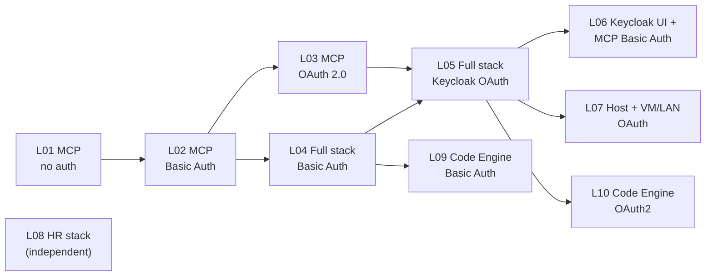

# Labs

This file gives every runnable setup in this repository a lab ID, an order to learn
them in, and the same short structure: goal, files used, start, verify, explore, stop.

It is a logical layer only. No file was moved: each lab points to the existing compose
files, scripts and detailed guides. Commands run from the repository root.

## Lab Catalog

| Lab | Name | Same as | Runs on | Auth | Services (host ports) |
| --- | --- | --- | --- | --- | --- |
| [L01](#l01-mcp-server-no-auth) | MCP server, no auth | MCP access option 1 | laptop | none | MCP 8084 |
| [L02](#l02-mcp-server-basic-auth) | MCP server, Basic Auth | MCP access option 2 | laptop | Basic | MCP 8084 |
| [L03](#l03-mcp-server-oauth-20) | MCP server, OAuth 2.0 (no implicit flow) | MCP access option 3 | laptop or LAN | OAuth 2.0 | Keycloak 8086, MCP 8084 |
| [L04](#l04-full-stack-basic-auth) | Full stack, Basic Auth | QUICKSTART Option 3 | laptop | Basic | REST 8082, REST UI 8083, MCP 8084, MCP UI 8085 |
| [L05](#l05-full-stack-keycloak-oauth) | Full stack, Keycloak OAuth | QUICKSTART Option 1 | laptop | OAuth 2.0 | Keycloak 8086, HR 8081, REST 8082, REST UI 8083, MCP 8084, MCP UI 8085, HR portal 8090 |
| [L06](#l06-keycloak-ui--mcp-basic-auth) | Keycloak UI + MCP Basic Auth | QUICKSTART Option 4 | laptop | mixed | Keycloak 8086, MCP 8084, MCP UI 8085 |
| [L07](#l07-host--vm--lan-oauth) | Host + VM / LAN OAuth | QUICKSTART Option 2 | host + second machine | OAuth 2.0 over LAN | as L05, reached through the host IP |
| [L08](#l08-hr-stack) | HR stack (Python or Java backend) | `start-hr-app.sh` | laptop | none | HR portal 8090 (Python HR API internal only; Java HR API 8089) |
| [L09](#l09-ibm-code-engine-basic-auth) | IBM Code Engine, Basic Auth | Code Engine Path A | IBM Cloud | Basic | HR, REST, REST UI, MCP, MCP UI |
| [L10](#l10-ibm-code-engine-oauth2) | IBM Code Engine, OAuth2 + Keycloak | Code Engine Path B | IBM Cloud | OAuth 2.0 | as L09 plus Keycloak |

The QUICKSTART option numbers and the Code Engine path letters stay valid; the "Same as"
column maps them.

## Learning Path

Each lab adds one idea to the previous one. Start where your knowledge ends.



| Step | Idea you add |
| --- | --- |
| L01 → L02 → L03 | How one MCP server is protected: nothing, a shared secret, signed tokens |
| L04 | REST and MCP side by side on the same business flow, without an identity provider |
| L05 | Real user login (Keycloak) for browsers and token checks in both backends |
| L06 | Browser identity and backend identity can differ |
| L07 | Why the token issuer URL must match the URL clients use |
| L09, L10 | The same stacks in the cloud |
| L08 | A separate HR demo; not part of the booking story |

## Before You Begin

- Docker Engine with Compose v2 (`docker`, `docker compose` on your PATH); `jq` and `python3` help in the explore steps.
- L09 and L10 need the IBM Cloud CLI instead; see their entries.
- **Run one lab at a time.** All local labs publish fixed host ports, and several share container names.
- Every REST or MCP backend start wipes and reseeds its demo data.
- L03 (LAN use) and L07 need the host IP:

  ```sh
  export LOCAL_NET_IP=$(ipconfig getifaddr en0)                    # macOS
  export LOCAL_NET_IP=$(ip route get 1.1.1.1 | awk '{print $NF; exit}')   # Linux
  ```

### Optional: `lab.sh`

[`local-container/lab.sh`](./local-container/lab.sh) is a thin wrapper around the commands below. It does not change any configuration; it saves you from repeating long `docker compose -f … -f …` lines and from stopping a lab with the wrong flags.

```sh
bash local-container/lab.sh list          # lab IDs and names
bash local-container/lab.sh up 04         # start a lab (L01–L08)
bash local-container/lab.sh verify 04     # run that lab's verify script
bash local-container/lab.sh down 04       # stop it
bash local-container/lab.sh status        # which lab is running right now
bash local-container/lab.sh down-all      # stop every running lab
```

Each lab below also shows the plain commands, so you can see what the wrapper runs.

## Credentials

Demo values only. Replace them before anything is reachable beyond your machine.

| Credential | Value | Used in |
| --- | --- | --- |
| Basic Auth (backends) | `demo-basic-user` / `demo-basic-password` | L02, L04, L06, L09 |
| Keycloak admin console | `admin` / `admin` | L03, L05, L06, L07 |
| Traveler (browser login) | `demo-user` / `demo-user-password` | L05, L06, L07, L10 |
| OAuth client for services and agents (`client_credentials`) | `web-app-proxy` / `web-app-proxy-secret` | L03, L05, L07 |

Override the Basic Auth pair in `local-container/basic-auth.env` (L04, L06) or in the lab's `mcp.env` (L02). Realm, clients and how to change them: [local-container/keycloak/README.md](./local-container/keycloak/README.md). The implicit flow is disabled for every client.

---

## L01: MCP Server, No Auth

**Goal:** see the MCP server, its endpoint and its six tools with nothing in the way.

**Uses:** [`local-container/booking_system_mcp_no_auth/`](./local-container/booking_system_mcp_no_auth/README.md) (`docker_compose.yaml`, `start.sh`, `verify.sh`)

```sh
bash local-container/booking_system_mcp_no_auth/start.sh          # or: lab.sh up 01
bash local-container/booking_system_mcp_no_auth/verify.sh         # or: lab.sh verify 01
```

**Explore:**
- Send an MCP `initialize` request to `http://localhost:8084/mcp` without any header. Expected: HTTP 200.
- List the tools (MCP Inspector: `bash local-container/start-mcp-inspector-ui.sh`, transport `Streamable HTTP`). Expected: `list_flights`, `book_flight`, `get_bookings`, `cancel_booking`, `register_user`, `get_user_id`.
- Book with a wrong name. Expected: a tool result with `isError: true`, not an HTTP error.

```sh
docker compose -f local-container/booking_system_mcp_no_auth/docker_compose.yaml down   # or: lab.sh down 01
```

More: [docs/mcp_access_options.md](./docs/mcp_access_options.md)

## L02: MCP Server, Basic Auth

**Goal:** protect the same server with one shared credential pair.

**Uses:** [`local-container/booking_system_mcp_basic_auth/`](./local-container/booking_system_mcp_basic_auth/README.md); optional `mcp.env` from `mcp.env.template`

```sh
bash local-container/booking_system_mcp_basic_auth/start.sh       # or: lab.sh up 02
bash local-container/booking_system_mcp_basic_auth/verify.sh      # or: lab.sh verify 02
```

**Explore:**
- Call `/mcp` without a header. Expected: `401` with `WWW-Authenticate: Basic`.
- Call it with `-u demo-basic-user:demo-basic-password`. Expected: 200.
- Compare with L01: the tools and their results do not change, only the request check.

```sh
docker compose -f local-container/booking_system_mcp_basic_auth/docker_compose.yaml down   # or: lab.sh down 02
```

## L03: MCP Server, OAuth 2.0

**Goal:** protect the server with short-lived tokens from Keycloak (`client_credentials` for agents, `authorization_code` + PKCE for interactive clients).

**Uses:** [`local-container/booking_system_mcp_oauth2_no_implicit_flow/`](./local-container/booking_system_mcp_oauth2_no_implicit_flow/README.md) (`docker_compose.yaml`, `start.sh`, `verify.sh`, `get-token.sh`), realm from [`local-container/keycloak/`](./local-container/keycloak/README.md)

```sh
bash local-container/booking_system_mcp_oauth2_no_implicit_flow/start.sh    # or: lab.sh up 03
bash local-container/booking_system_mcp_oauth2_no_implicit_flow/verify.sh   # or: lab.sh verify 03
```

**Explore:**
- Get a token: `export GALAXIUM_MCP_ACCESS_TOKEN="$(bash local-container/booking_system_mcp_oauth2_no_implicit_flow/get-token.sh)"`.
- Decode its payload and look at `iss`. Expected: `http://localhost:8086/realms/galaxium`, the value of `KEYCLOAK_PUBLIC_BASE_URL`.
- Read `http://localhost:8084/.well-known/oauth-authorization-server`. Expected: `response_types_supported` is `["code"]` (no implicit flow).
- For LAN clients (for example watsonx Orchestrate Developer Edition) set `KEYCLOAK_PUBLIC_BASE_URL` and `MCP_PUBLIC_BASE_URL` to `http://${LOCAL_NET_IP}:…` in `mcp.env`, restart, and see `iss` change. L07 explains why this matters.

```sh
docker compose -f local-container/booking_system_mcp_oauth2_no_implicit_flow/docker_compose.yaml down   # or: lab.sh down 03
```

## L04: Full Stack, Basic Auth

**Goal:** run the REST path and the MCP path side by side, each with its own web UI, without Keycloak.

**Uses:** [`local-container/docker_compose.basic-auth.yaml`](./local-container/docker_compose.basic-auth.yaml), optional `local-container/basic-auth.env` from `basic-auth.env.template`

```sh
docker compose --env-file local-container/basic-auth.env \
  -f local-container/docker_compose.basic-auth.yaml up --build -d    # or: lab.sh up 04
```

Leave out `--env-file …` if you did not create `basic-auth.env`; the demo credentials are the defaults.

**Verify:** `bash local-container/verify-basic-auth-backends.sh` and `bash local-container/verify-basic-auth-frontends-and-inspector.sh` (or `lab.sh verify 04`). Both scripts start this stack themselves and stop it when they finish.

**Explore:**
- Open `http://localhost:8083` (REST UI) and `http://localhost:8085` (MCP UI). No login screen: each UI keeps a guest traveler in the browser session and sends the shared Basic Auth header to its backend.
- Book a flight in the REST UI, then look for it in the MCP UI. Expected: it is not there. The two paths keep independent databases ([ARCHITECTURE.md](./ARCHITECTURE.md#scope-and-boundaries)).
- Compare `http://localhost:8082/docs` (REST operations) with the MCP tool list from L01.

```sh
docker compose --env-file local-container/basic-auth.env \
  -f local-container/docker_compose.basic-auth.yaml down             # or: lab.sh down 04
```

**Variant L04-vm:** [`local-container/docker_compose.basic-auth-vm.yaml`](./local-container/docker_compose.basic-auth-vm.yaml) starts the same four services with `_vm` container names and an explicit `mcp-network` bridge network (`lab.sh up 04-vm`). LAN clients use [`local-container/vm-client-basic-auth.env.template`](./local-container/vm-client-basic-auth.env.template) with either file. The two verify scripts always use `docker_compose.basic-auth.yaml`, so verify with L04.

## L05: Full Stack, Keycloak OAuth

**Goal:** add real user login. Browsers log in through Keycloak, and both backends validate bearer tokens.

**Uses:** [`local-container/docker_compose.yaml`](./local-container/docker_compose.yaml), realm [`local-container/keycloak/realm/galaxium-realm.json`](./local-container/keycloak/realm/galaxium-realm.json)

```sh
docker compose -f local-container/docker_compose.yaml up --build -d   # or: lab.sh up 05
```

Only one path: append `keycloak booking_system web_app` (REST) or `keycloak booking_system_mcp web_app_mcp` (MCP).

**Verify:** `bash local-container/verify-keycloak-auth-e2e.sh` (or `lab.sh verify 05`). Focused slices: `verify-keycloak-auth.sh` (REST) and `verify-keycloak-auth-mcp.sh` (MCP).

**Explore:**
- Log in at `http://localhost:8083` and `http://localhost:8085` as `demo-user`. Same traveler flow, different backend protocol.
- Call `http://localhost:8082/flights` and `http://localhost:8084/mcp` without a token. Expected: `401`. (`/health` stays open.)
- In the Keycloak console (`http://localhost:8086`, realm `galaxium`) look at the clients and their allowed grants.
- Read the issuer note in [AGENTS.md](./AGENTS.md#compose-environment-for-oidc): backends reach Keycloak as `keycloak:8080`, your browser as `localhost:8086`.
- The HR API (`http://localhost:8081/docs`) and HR portal (`http://localhost:8090`) also run here, without auth.

```sh
docker compose -f local-container/docker_compose.yaml down             # or: lab.sh down 05
```

More: [local-container/README.md](./local-container/README.md#option-1-local-machine), [docs/manual_auth_check_using_the_commandline.md](./docs/manual_auth_check_using_the_commandline.md)

## L06: Keycloak UI + MCP Basic Auth

**Goal:** see that the browser user's identity and the backend's identity are separate. The traveler logs in through Keycloak, while the MCP UI calls the MCP server with the shared Basic Auth pair.

**Uses:** [`local-container/docker_compose.yaml`](./local-container/docker_compose.yaml) + overlay [`local-container/docker_compose.mcp-ui-keycloak-basic.yaml`](./local-container/docker_compose.mcp-ui-keycloak-basic.yaml), optional `local-container/basic-auth.env`

```sh
docker compose --env-file local-container/basic-auth.env \
  -f local-container/docker_compose.yaml \
  -f local-container/docker_compose.mcp-ui-keycloak-basic.yaml \
  up --build -d keycloak booking_system_mcp web_app_mcp                # or: lab.sh up 06
```

**Verify:** `bash local-container/verify-keycloak-ui-basic-auth-mcp.sh` (or `lab.sh verify 06`).

**Explore:**
- Log in at `http://localhost:8085` as `demo-user` and book a flight.
- Call `http://localhost:8084/mcp` with a Keycloak token instead of Basic Auth. Expected: `401`, because the backend only accepts Basic Auth in this lab.
- Diff the overlay against the base file to see which variables switch the auth mode.

```sh
docker compose --env-file local-container/basic-auth.env \
  -f local-container/docker_compose.yaml \
  -f local-container/docker_compose.mcp-ui-keycloak-basic.yaml down    # or: lab.sh down 06
```

## L07: Host + VM / LAN OAuth

**Goal:** let an app or agent on another machine use the stack. Understand why the token issuer must be the URL that clients use.

**Uses:** [`local-container/docker_compose.yaml`](./local-container/docker_compose.yaml) + overlay [`local-container/docker_compose.vm-oauth.yaml`](./local-container/docker_compose.vm-oauth.yaml); host env `local-container/vm-oauth.env` (from `vm-oauth.env.template`); client env `local-container/vm-client.env` (from `vm-client.env.template`)

```sh
cp local-container/vm-oauth.env.template local-container/vm-oauth.env   # set the host IP, not localhost
docker compose --env-file local-container/vm-oauth.env \
  -f local-container/docker_compose.yaml \
  -f local-container/docker_compose.vm-oauth.yaml up --build -d         # or: lab.sh up 07
```

**Verify:** copy `local-container/verify-keycloak-auth-remote.env.template` to `verify-keycloak-auth-remote.env`, then run `bash local-container/verify-keycloak-auth-remote.sh --env-file local-container/verify-keycloak-auth-remote.env` (or `lab.sh verify 07`).

**Explore:**
- `curl -s http://${LOCAL_NET_IP}:8086/realms/galaxium/.well-known/openid-configuration | jq -r .issuer`. Expected: the host IP URL, not `keycloak:8080`.
- From the second machine, get a token from the host IP and call `http://${LOCAL_NET_IP}:8084/mcp`. Expected: 200. Repeat against L05 without the overlay to see `invalid_token`.

```sh
docker compose --env-file local-container/vm-oauth.env \
  -f local-container/docker_compose.yaml \
  -f local-container/docker_compose.vm-oauth.yaml down                  # or: lab.sh down 07
```

More: [local-container/README.md — Why This OAuth Setup Works](./local-container/README.md#why-this-oauth-setup-works)

## L08: HR Stack

**Goal:** run the HR portal (Quarkus + React) against the Python or the Java HR backend. Both backends serve the same `/employees` and `/jobs` contract from Markdown tables.

**Uses:** [`hr_database_frontend_java/`](./hr_database_frontend_java/README.md) (`start-hr-app.sh`, `stop-hr-app.sh`, `docker-compose.yaml`, `docker-compose.java-backend.yaml`)

```sh
bash hr_database_frontend_java/start-hr-app.sh --backend python   # or java; lab.sh up 08 (HR_BACKEND=java for Java)
```

**Verify:** no verify script. `lab.sh verify 08` checks `http://localhost:8090/q/health/ready`.

**Explore:**
- Open `http://localhost:8090` and change an employee. With the Python backend, `hr_database_backend/data` is mounted into the container, so `git diff hr_database_backend/data/employees.md` shows your change. Run `git checkout hr_database_backend/data` to undo it.
- Switch to `--backend java` and confirm the portal behaves the same.

```sh
bash hr_database_frontend_java/stop-hr-app.sh --backend python    # or: lab.sh down 08
```

The HR containers use the same names as the HR services in L05. Stop one before starting the other.

## L09: IBM Code Engine, Basic Auth

**Goal:** deploy the L04 idea to IBM Code Engine.

**Uses:** [`deployment/ibm-code-engine/deploy-stack.sh`](./deployment/ibm-code-engine/deploy-stack.sh), `deploy.env` from `deploy.env.template`, numbered steps in `deployment/ibm-code-engine/scripts/`

Start, verify and teardown (`teardown-stack.sh`) are in [DEPLOY-PATH-A-BASIC-AUTH.md](./deployment/ibm-code-engine/DEPLOY-PATH-A-BASIC-AUTH.md). `export-deployment.sh --basic` writes the live URLs and config to `generated/exports/`.

## L10: IBM Code Engine, OAuth2

**Goal:** deploy the L05 idea to IBM Code Engine, with Keycloak in the same project.

**Uses:** [`deployment/ibm-code-engine/deploy-stack-oauth2.sh`](./deployment/ibm-code-engine/deploy-stack-oauth2.sh), `deploy.env.oauth2` from `deploy.env.oauth2.template`

Start, verify and teardown (`teardown-stack-oauth2.sh`) are in [DEPLOY-PATH-B-OAUTH2.md](./deployment/ibm-code-engine/DEPLOY-PATH-B-OAUTH2.md). `export-deployment.sh --oauth2` writes the live URLs and config.

---

## Troubleshooting

| Symptom | Cause | Fix |
| --- | --- | --- |
| `port is already allocated` | Another lab is still running | `bash local-container/lab.sh status`, then `down-all` |
| `container name "/hr_database" is already in use` | L05 and L08 share HR container names | Stop the other lab first |
| `invalid_token` from a LAN client | Token issuer differs from the issuer the backend expects | Use L07, or set `KEYCLOAK_PUBLIC_BASE_URL` in L03 |
| A booking disappeared | Every backend start reseeds its data | Expected behavior |
