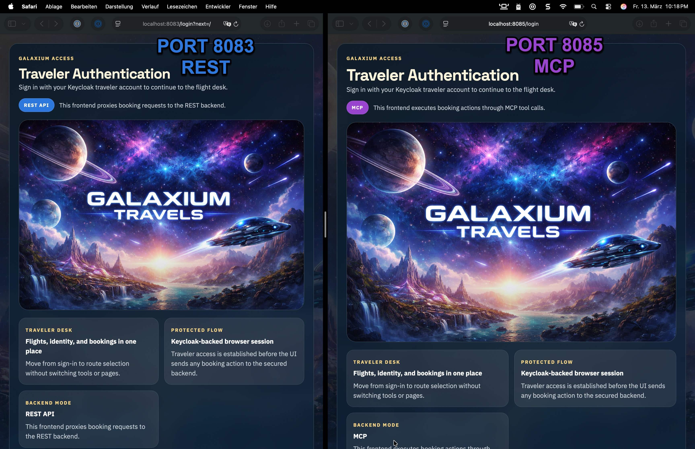
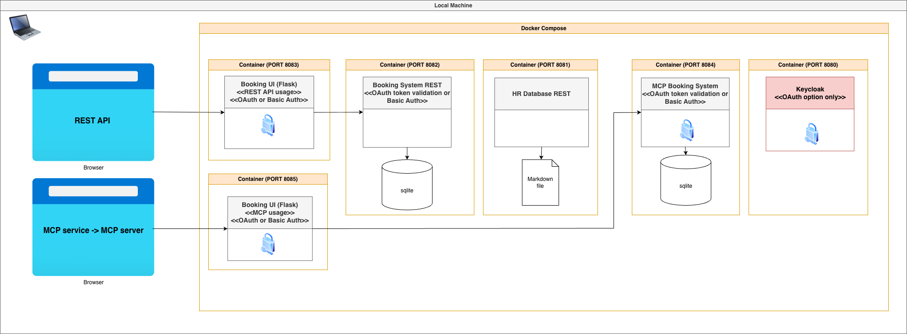
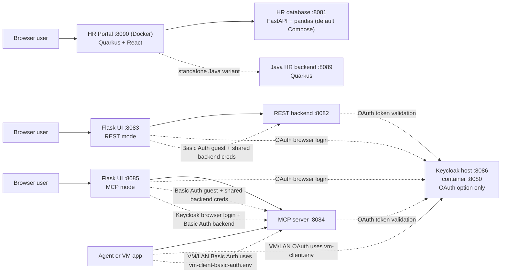

[](https://github.com/thomassuedbroecker/galaxium-travels-infrastructure-tsuedbro/actions/workflows/tests.yml)
[](https://github.com/thomassuedbroecker/galaxium-travels-infrastructure-tsuedbro/actions/workflows/dco.yml)
[](LICENSE)

# Galaxium Travels Infrastructure

## Objective

The main objective of this repository is to provide an example application that combines traditional application infrastructure with AI-ready functionality.

The current implementation uses the same travel-booking business flow in two styles:

- a REST backend and a REST-based web UI
- an MCP server and an MCP-based web UI

This makes it possible to evaluate where AI-oriented integration fits best: in the frontend, in the backend, or in both.

The practical architecture question this project helps you explore is:

Should an AI-ready application stay with REST, move to MCP, or support both?

## What You Can Run

- the same Keycloak OAuth flow for both REST and MCP
- a shared Basic Auth variant for the REST backend, MCP server, REST UI, and MCP UI
- a mixed MCP variant where the browser user logs in with Keycloak but the MCP backend itself uses shared Basic Auth
- the MCP server on its own in three access options: no auth, Basic Auth, or OAuth 2.0 without the implicit flow (`local-container/booking_system_mcp_*`; see [docs/mcp_access_options.md](./docs/mcp_access_options.md)). `booking_system_mcp` is the only service provided as MCP, and these folders are the base for the [watsonx Orchestrate guide repository](https://github.com/thomassuedbroecker/galaxium-travels-watsonx-orchestrate-mcp-bob-guide)

This repository is not meant to claim that MCP always replaces REST. It is meant to let you compare both approaches on the same business case and make a better architectural decision.

The comparison idea also matches the blog post [Should MCP replace REST for AI-ready applications?](https://suedbroecker.net/2026/03/10/should-mcp-replace-rest-for-ai-ready-applications/).

For deployment, the repository provides supported IBM Code Engine deployment packages in `deployment/ibm-code-engine/` supporting both Path A (Basic Auth via `deploy-stack.sh`) and Path B (OAuth2 via `deploy-stack-oauth2.sh`).

Editable source diagram: [architecture/galaxim-travel-infrastructure.drawio](./architecture/galaxim-travel-infrastructure.drawio)



## Why This Repo Is Useful

- You can compare REST and MCP in one small, understandable business domain.
- You can test browser users, backends, and AI-style tool access with both Keycloak OAuth and shared Basic Auth.
- You can compare pure OAuth, pure Basic Auth, and a mixed `Keycloak UI -> MCP Basic Auth` path in the same demo.
- You can run everything on one local machine.
- You can also prepare the stack for a VM or LAN setup where OAuth needs public host URLs.
- The Basic Auth runtime is available as both `local-container/docker_compose.basic-auth.yaml` and `local-container/docker_compose.basic-auth-vm.yaml`.
- You can choose the matching env template for each option: `local-container/vm-client.env.template`, `local-container/basic-auth.env.template`, or `local-container/vm-client-basic-auth.env.template`.

## Architecture At A Glance



## Start Here

- Navigation hub (all paths at a glance): [NAVIGATOR.md](./NAVIGATOR.md)
- New user path: [QUICKSTART.md](./QUICKSTART.md)
- Contributing and DCO sign-off: [CONTRIBUTING.md](./CONTRIBUTING.md)
- Runtime boundaries and architecture decisions: [ARCHITECTURE.md](./ARCHITECTURE.md)
- Local compose, VM/LAN OAuth, and Basic Auth details: [local-container/README.md](./local-container/README.md)
- MCP server access options (no auth / Basic Auth / OAuth 2.0) for MCP clients such as watsonx Orchestrate: [docs/mcp_access_options.md](./docs/mcp_access_options.md)
- Keycloak configuration and how to adjust it: [local-container/keycloak/README.md](./local-container/keycloak/README.md)
- Test commands and current test scope: [testing/README.md](./testing/README.md)
- AI engineer / agent integration guide: [docs/AI_ENGINEER_GUIDE.md](./docs/AI_ENGINEER_GUIDE.md)
- Manual MCP auth walkthrough with Inspector CLI: [docs/manual_auth_check_using_the_commandline.md](./docs/manual_auth_check_using_the_commandline.md)
- WebUI auth matrix details: [testing/webui_matrix/README.md](./testing/webui_matrix/README.md)
- Project quality review: [docs/QUALITY-CHECK.md](./docs/QUALITY-CHECK.md)
- IBM Code Engine deployment guides: [Overview](./deployment/ibm-code-engine/README.md) | [Path A (Basic Auth)](./deployment/ibm-code-engine/DEPLOY-PATH-A-BASIC-AUTH.md) | [Path B (OAuth2)](./deployment/ibm-code-engine/DEPLOY-PATH-B-OAUTH2.md) | Source packaging: [`.ceignore`](./.ceignore)

## Main Services

| Path | Purpose | Default port | Main entry point |
| --- | --- | --- | --- |
| `booking_system_rest/` | FastAPI booking backend with independent SQLite state | `8082` | `app.py` |
| `booking_system_mcp/` | MCP server with independent SQLite state for the equivalent booking domain | `8084` | `mcp_server.py` |
| `galaxium-booking-web-app/` | Flask UI that calls the REST backend | `8083` | `app/app.py` |
| `galaxium-booking-web-app-mcp/` | Flask UI that calls MCP tools through a direct Python MCP client | `8085` | `app/app.py` |
| `hr_database_backend/` | Small HR API backed by markdown data | `8081` | `app.py` |
| `hr_database_backend_java/` | Alternative Quarkus HR API (employees + jobs) backed by `data/employees.md` and `data/jobs.md`; standalone HR stack | `8089` | `mvn quarkus:dev` |
| `hr_database_frontend_java/` | Quarkus + React HR portal; proxies CRUD calls to the Python or Java HR backend | `8090` (container) / `8088` (local) | `start-hr-app.sh` / `mvn quarkus:dev` |
| `local-container/` | Docker Compose setup, OAuth and Basic Auth verifier scripts, env templates | n/a | `docker_compose.yaml` |

The REST and MCP paths model equivalent traveler actions, but they do not
share a database. A booking created in one path is not synchronized to the
other. See [ARCHITECTURE.md](./ARCHITECTURE.md) for the runtime boundary and
auth-mode comparison.

## Verification Evidence

For test commands, scope, and the current verified state see [testing/README.md](./testing/README.md).

## First-Time Setup

After cloning, run the one-time hook setup so every commit is signed off
automatically (required by the DCO check on pull requests):

```sh
bash setup-hooks.sh
```

## Fast Validation

Run the REST API tests:

```sh
(cd booking_system_rest && python3 -m pytest tests -q)
```

Run the local-container contract tests:

```sh
bash testing/automation/run-local-container-contract-tests.sh
```

Run the compose OAuth smoke test:

```sh
bash local-container/verify-keycloak-auth-e2e.sh
```

Run the local Basic Auth backend smoke test:

```sh
bash local-container/verify-basic-auth-backends.sh
```

Run the local Basic Auth frontend plus Inspector smoke test:

```sh
bash local-container/verify-basic-auth-frontends-and-inspector.sh
```

Run the Keycloak UI + MCP Basic Auth smoke test:

```sh
bash local-container/verify-keycloak-ui-basic-auth-mcp.sh
```

Run one MCP-only access option (replace `basic_auth` with `no_auth` or `oauth2_no_implicit_flow`):

```sh
bash local-container/booking_system_mcp_basic_auth/start.sh
bash local-container/booking_system_mcp_basic_auth/verify.sh
docker compose -f local-container/booking_system_mcp_basic_auth/docker_compose.yaml down
```

Run the current aggregate repo regression slice:

```sh
bash testing/automation/run-all-tests.sh
```

Run the WebUI auth matrix with the local template:

```sh
cp testing/webui_matrix/local-machine-network.env.template testing/webui_matrix/local-machine-network.env
bash testing/automation/run-webui-auth-matrix.sh --env-file testing/webui_matrix/local-machine-network.env
```

## Open-Source Dependencies

This repository contains multiple Python services, each with its own
`requirements.txt`, one Quarkus HR backend and one Quarkus + React portal managed via Maven (`pom.xml`)
and npm (`package.json`), and no single root lockfile.

The tables below show the direct dependencies declared in the repository as of
`2026-10-15`. Where a service does not pin an exact version, the entry is marked
as `not pinned`.

Current declared base images:

| Service | Base image(s) |
| --- | --- |
| `booking_system_rest/` | `python:3.11-slim` |
| `booking_system_mcp/` | `python:3.11-slim` |
| `hr_database_backend/` | `python:3.11-slim` |
| `galaxium-booking-web-app/` | `python:3.12-slim` |
| `galaxium-booking-web-app-mcp/` | `python:3.12-slim` |
| `hr_database_frontend_java/` | build: `maven:3.9-eclipse-temurin-21`; runtime: `eclipse-temurin:21-jre-jammy` |
| `hr_database_backend_java/` | build: `maven:3.9-eclipse-temurin-21`; runtime: `eclipse-temurin:21-jre-jammy` |

Current declared main runtime libraries — Python services:

| Library | Declared version in this repo | License | Where referenced |
| --- | --- | --- | --- |
| `fastapi` | `not pinned`; `0.104.1` in `hr_database_backend/requirements.txt` | MIT | `booking_system_rest/requirements.txt`, `booking_system_mcp/requirements.txt`, `hr_database_backend/requirements.txt` |
| `uvicorn` | `not pinned`; `0.24.0` in `hr_database_backend/requirements.txt` | BSD-3-Clause | `booking_system_rest/requirements.txt`, `booking_system_mcp/requirements.txt`, `hr_database_backend/requirements.txt` |
| `sqlalchemy` | `not pinned` | MIT | `booking_system_rest/requirements.txt`, `booking_system_mcp/requirements.txt` |
| `databases` | `not pinned` | BSD | `booking_system_rest/requirements.txt`, `booking_system_mcp/requirements.txt` |
| `pydantic` / `pydantic[email]` | `not pinned`; `2.4.2` in `hr_database_backend/requirements.txt` | MIT | `booking_system_rest/requirements.txt`, `booking_system_mcp/requirements.txt`, `hr_database_backend/requirements.txt` |
| `python-dotenv` | `not pinned` | BSD-3-Clause | `booking_system_rest/requirements.txt`, `booking_system_mcp/requirements.txt` |
| `fastmcp` | `not pinned` | Apache-2.0 | `booking_system_mcp/requirements.txt` |
| `PyJWT[crypto]` | `not pinned` | MIT | `booking_system_rest/requirements.txt`, `booking_system_mcp/requirements.txt` |
| `python-multipart` | `0.0.6` | Apache-2.0 | `hr_database_backend/requirements.txt` |
| `pandas` | `not pinned` | BSD-3-Clause | `hr_database_backend/Dockerfile` |
| `Flask` | `3.1.1` | BSD-3-Clause | `galaxium-booking-web-app/app/requirements.txt`, `galaxium-booking-web-app-mcp/app/requirements.txt` |
| `flask-cors` | `3.0.10` | MIT | `galaxium-booking-web-app/app/requirements.txt`, `galaxium-booking-web-app-mcp/app/requirements.txt` |
| `requests` | `2.31.0` | Apache-2.0 | `galaxium-booking-web-app/app/requirements.txt`, `galaxium-booking-web-app-mcp/app/requirements.txt` |
| `httpx` | `not pinned` in REST tests; `0.28.1` in MCP frontend | BSD-3-Clause | `booking_system_rest/requirements.txt`, `galaxium-booking-web-app-mcp/app/requirements.txt` |
| `mcp` | `>=1.26.0,<2` | MIT | `galaxium-booking-web-app-mcp/app/requirements.txt` |

Current declared main runtime libraries — Quarkus + React (`hr_database_frontend_java/`):

The Java backend also declares Quarkus BOM `3.37.0`,
`quarkus-rest-jackson`, `quarkus-smallrye-openapi`, and
`quarkus-smallrye-health`; its test dependencies are `quarkus-junit5` and
`rest-assured` (Apache-2.0 project licenses; versions managed by the BOM).

| Library / Component | Declared version | License | Where referenced |
| --- | --- | --- | --- |
| Quarkus BOM | `3.37.0` | Apache-2.0 | `hr_database_frontend_java/pom.xml` |
| `quarkus-rest-jackson` | managed by BOM | Apache-2.0 | `hr_database_frontend_java/pom.xml` |
| `quarkus-rest-client-jackson` | managed by BOM | Apache-2.0 | `hr_database_frontend_java/pom.xml` |
| `quarkus-smallrye-openapi` | managed by BOM | Apache-2.0 | `hr_database_frontend_java/pom.xml` |
| `quarkus-smallrye-health` | managed by BOM | Apache-2.0 | `hr_database_frontend_java/pom.xml` |
| `quarkus-config-yaml` | managed by BOM | Apache-2.0 | `hr_database_frontend_java/pom.xml` |
| `react` | `^18.3.1` | MIT | `hr_database_frontend_java/src/main/webapp/package.json` |
| `react-dom` | `^18.3.1` | MIT | `hr_database_frontend_java/src/main/webapp/package.json` |
| `react-router-dom` | `^6.28.0` | MIT | `hr_database_frontend_java/src/main/webapp/package.json` |
| Node.js (build) | `v20.19.3` | MIT | `hr_database_frontend_java/pom.xml` (frontend-maven-plugin) |
| npm (build) | `10.9.2` | Artistic-2.0 | `hr_database_frontend_java/pom.xml` (frontend-maven-plugin) |
| Vite (build) | `^5.4.14` | MIT | `hr_database_frontend_java/src/main/webapp/package.json` |
| `@types/react`, `@types/react-dom` (build) | `^18.3.1` | MIT | `hr_database_frontend_java/src/main/webapp/package.json` |
| `@vitejs/plugin-react` (build) | `^4.3.4` | MIT | `hr_database_frontend_java/src/main/webapp/package.json` |

Current declared dev and test libraries — Python services:

| Library | Declared version in this repo | License | Where referenced |
| --- | --- | --- | --- |
| `pytest` | `not pinned` | MIT | `booking_system_rest/requirements.txt` |
| `pytest-asyncio` | `not pinned` | Apache-2.0 | `booking_system_rest/requirements.txt` |
| `pytest-cov` | `not pinned` | MIT | `booking_system_rest/requirements.txt` |
| `pytest-mock` | `not pinned` | MIT | `booking_system_rest/requirements.txt` |

Current declared dev and test libraries — Quarkus (`hr_database_frontend_java/`):

| Library | Declared version | License | Where referenced |
| --- | --- | --- | --- |
| `quarkus-junit5` | managed by BOM | Apache-2.0 | `hr_database_frontend_java/pom.xml` |
| `rest-assured` | managed by BOM | Apache-2.0 | `hr_database_frontend_java/pom.xml` |

The repository itself is licensed under Apache-2.0 in `LICENSE`.

Dependency declarations are split across the individual service folders:
`requirements.txt` for Python services, `pom.xml` + `package.json` for
`hr_database_frontend_java/`, plus `pom.xml` for `hr_database_backend_java/`. The React frontend has a committed `package-lock.json`; its Maven build currently
runs `npm install`. No single root lockfile or automated license-audit script
is currently provided. See the [detailed dependency inventory](docs/DEPENDENCY_LICENSE_TRANSPARENCY.md)
and [third-party notices](THIRD_PARTY_NOTICES.md) for coverage and limitations.

## Repository Layout

```text
.
├── AGENTS.md               ← agent rules, patterns, commands (canonical)
├── ARCHITECTURE.md
├── CONTRIBUTING.md
├── HANDOFF.md              ← current branch state and session log
├── NAVIGATOR.md
├── QUICKSTART.md
├── LLMS.txt
├── setup-hooks.sh          ← run once after cloning to auto-sign commits (DCO)
├── .githooks/
│   └── commit-msg          ← appends Signed-off-by to every commit automatically
├── .github/
│   ├── workflows/
│   │   ├── dco.yml         ← CI gate: verifies DCO trailer on every PR
│   │   ├── tests.yml       ← CI: REST unit, contracts, WebUI unit (no Docker)
│   │   └── bob-pr-review.yml
│   └── pull_request_template.md
├── docs/
│   ├── AI_ENGINEER_GUIDE.md
│   ├── QUALITY-CHECK.md
│   ├── DEPENDENCY_LICENSE_TRANSPARENCY.md
│   ├── manual_auth_check_using_the_commandline.md
│   ├── mcp_access_options.md    ← MCP no auth / Basic Auth / OAuth 2.0 options
│   ├── watsonx_orchestrate_basic_auth_example_integration.md
│   └── reference/               ← supplemental background (not required for first run)
├── hr_database_backend/             ← FastAPI + pandas HR data API (port 8081)
├── hr_database_backend_java/     ← alternative Quarkus HR API (port 8089; standalone HR stack)
├── hr_database_frontend_java/    ← Quarkus + React HR portal (port 8090/container, 8088/local)
├── booking_system_mcp/
├── booking_system_rest/
├── galaxium-booking-web-app/
├── galaxium-booking-web-app-mcp/
├── local-container/
│   ├── docker_compose*.yaml          ← full stacks (Options 1–4)
│   ├── keycloak/                     ← realm import + Keycloak guide
│   ├── booking_system_mcp_no_auth/   ← MCP only, AUTH_MODE=none
│   ├── booking_system_mcp_basic_auth/ ← MCP only, AUTH_MODE=basic
│   └── booking_system_mcp_oauth2_no_implicit_flow/ ← MCP + Keycloak, AUTH_MODE=oauth2
├── testing/
└── deployment/
```

## Notes

- This repository is a strong demo and learning project, not a finished production platform.
- The code is structured so you can grow it toward production by improving CI, observability, release handling, and shared frontend code.
- `docs/reference/` contains extra background and older notes. It is not required for a first run.
