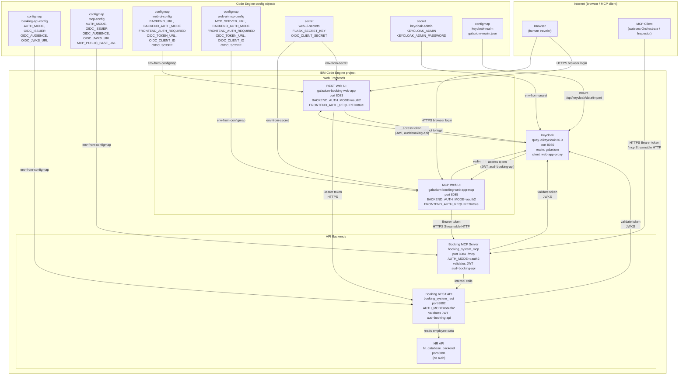
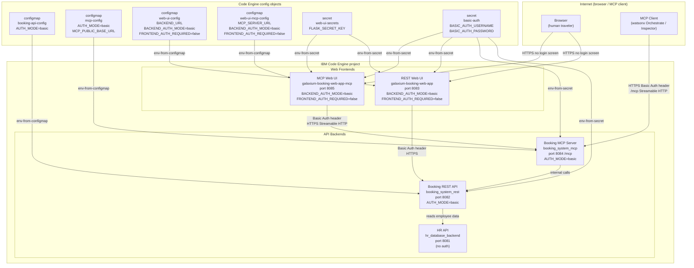

# IBM Code Engine Deployment

This folder automates the deployment of the full Galaxium Travels stack to IBM Code Engine
using bash scripts and the IBM Cloud CLI. It is the only supported deployment package in this
repository, preconfigured for the `basic` auth path first.

Runtime configuration model:
- `deploy-stack.sh` is the primary entrypoint for the default basic auth path.
- Each numbered script in `scripts/` is self-contained and can be run directly without sourcing a shared helper file first.
- The scripts use Code Engine configmaps for per-service non-secret runtime settings.
- `scripts/04-deploy-services.sh` renders env files for each deployed service variant into `generated/` and applies them using `--env-from-configmap`, leaving visible config artifacts for debugging and auditing.

Services deployed:

| Service | Source directory | Container port |
|---|---|---|
| Keycloak *(oauth2 only)* | `quay.io/keycloak/keycloak:26.0` | 8080 |
| HR API | `hr_database_backend/` | 8081 |
| Booking REST API | `booking_system_rest/` | 8082 |
| REST Web UI | `galaxium-booking-web-app/` | 8083 |
| Booking MCP server | `booking_system_mcp/` | 8084 |
| MCP Web UI | `galaxium-booking-web-app-mcp/` | 8085 |

Ports above are **container listen ports**. Public access always uses the generated
Code Engine HTTPS application URL — there are no fixed public ports.

Two auth modes are supported. Pick one before you start:

| Mode | Keycloak | Browser login | Entrypoint | Env file |
|---|---|---|---|---|
| `basic` *(default)* | not deployed | no login screen | `deploy-stack.sh` | `deploy.env` |
| `oauth2` | deployed in-project | OIDC browser login | `deploy-stack-oauth2.sh` | `deploy.env.oauth2` |

---

## Architecture Diagrams

### OAuth2 Stack (`STACK_AUTH_MODE=oauth2`)

All services run inside a single IBM Code Engine project.
Both web UIs authenticate users via browser login (Keycloak OIDC).
Backends validate Bearer tokens issued by Keycloak.
`deploy-stack-oauth2.sh` is the entrypoint for this configuration.



---

### Basic Auth Stack (`STACK_AUTH_MODE=basic`)

Keycloak is not deployed.
Both web UIs run in guest mode (no browser login screen).
Backends authenticate every request with a shared username and password.
`deploy-stack.sh` is the entrypoint for this configuration.



---

## Deployment Guides

Each path is documented in its own dedicated file.
Read only the file that matches your chosen auth mode — no cross-referencing required.

| | Path A — Basic Auth | Path B — OAuth2 |
|---|---|---|
| **Guide** | **[DEPLOY-PATH-A-BASIC-AUTH.md](./DEPLOY-PATH-A-BASIC-AUTH.md)** | **[DEPLOY-PATH-B-OAUTH2.md](./DEPLOY-PATH-B-OAUTH2.md)** |
| **Entrypoint** | `deploy-stack.sh` | `deploy-stack-oauth2.sh` |
| **Env file** | `deploy.env` | `deploy.env.oauth2` |
| **Keycloak** | not deployed | deployed in-project |
| **Browser login** | no login screen | OIDC login required |
| **Scripts that run** | `00 → 01 → 02 → [02b] → 04 → 06` | `00 → 01 → 02 → [02b] → 03 → 04 → 05 → 06` |
| **[02b] skips when** | `source_build` mode | `source_build` mode |
| **03 skips when** | always (basic mode) | `KEYCLOAK_BASE_URL_OVERRIDE` is set |
| **05 skips when** | always (basic mode) | `KEYCLOAK_BASE_URL_OVERRIDE` is set |

### Quick start

**Basic Auth:**

```sh
cd deployment/ibm-code-engine
cp deploy.env.template deploy.env
# edit deploy.env — set FLASK_SECRET_KEY, BASIC_AUTH_USERNAME, BASIC_AUTH_PASSWORD
bash deploy-stack.sh
```

**OAuth2:**

```sh
cd deployment/ibm-code-engine
cp deploy.env.oauth2.template deploy.env.oauth2
# edit deploy.env.oauth2 — set KEYCLOAK_ADMIN_PASSWORD, OIDC_CLIENT_SECRET, FLASK_SECRET_KEY
bash deploy-stack-oauth2.sh
```

→ Full step-by-step instructions, env file tables, script-by-script breakdown, verification
commands, and debug tips are in the dedicated path guides above.

---

## Reference

### Files in this folder

| File | Purpose |
|---|---|
| [`deploy-stack.sh`](./deploy-stack.sh) | Basic Auth deployment entrypoint; runs all scripts in order |
| [`deploy-stack-oauth2.sh`](./deploy-stack-oauth2.sh) | OAuth2 deployment entrypoint; locks `STACK_AUTH_MODE=oauth2`; reads `deploy.env.oauth2` first |
| [`export-deployment.sh`](./export-deployment.sh) | Exports the live deployment links and configuration (links as `.md`/`.env`, configmaps and applications as JSON) to `generated/exports/`. Without arguments it exports every existing env file (`deploy.env` and `deploy.env.oauth2`), one folder each; `--basic` / `--oauth2` select one; `ENV_FILE=...` selects a custom file. Secret values are never exported |
| [`teardown-stack.sh`](./teardown-stack.sh) | Basic Auth teardown; removes all apps, configmaps, and secrets from the project without deleting it |
| [`teardown-stack-oauth2.sh`](./teardown-stack-oauth2.sh) | OAuth2 teardown; removes all apps, configmaps, and secrets from the project without deleting it |
| [`deploy.env.template`](./deploy.env.template) | Template for Basic Auth env file; copy to `deploy.env` |
| [`deploy.env.oauth2.template`](./deploy.env.oauth2.template) | Template for OAuth2 env file; copy to `deploy.env.oauth2` |
| [`../../.ceignore`](../../.ceignore) | Workspace ignore file at repo root; excludes virtualenvs, `.git`, target folders, and assets from Code Engine source build uploads |
| [`generated/`](./generated/) | Rendered per-service env files (git-ignored); kept for local inspection after deploy |
| [`scripts/00-prereqs.sh`](./scripts/00-prereqs.sh) | Checks CLI tools, plugin versions, and env mode summary |
| [`scripts/01-project.sh`](./scripts/01-project.sh) | Creates or selects the Code Engine project |
| [`scripts/02-config-and-secrets.sh`](./scripts/02-config-and-secrets.sh) | Creates secrets and static configmaps (Keycloak realm import, registry secret) |
| [`scripts/02b-build-and-push-images.sh`](./scripts/02b-build-and-push-images.sh) | Builds and pushes five Galaxium images to IBM Cloud Container Registry (`prebuilt_images` mode only) |
| [`scripts/03-deploy-keycloak.sh`](./scripts/03-deploy-keycloak.sh) | Deploys Keycloak in-project (`oauth2` mode only; skipped if `KEYCLOAK_BASE_URL_OVERRIDE` is set) |
| [`scripts/04-deploy-services.sh`](./scripts/04-deploy-services.sh) | Deploys all five Galaxium services; resolves URLs between phases; writes `generated/` env files |
| [`scripts/05-sync-keycloak-client.sh`](./scripts/05-sync-keycloak-client.sh) | Updates Keycloak `web-app-proxy` client with final Code Engine UI URLs (`oauth2` mode only) |
| [`scripts/06-summary.sh`](./scripts/06-summary.sh) | Prints public URLs, config names, and smoke-test `curl` commands |

### Key environment variables

| Variable | Applies to | Description |
|---|---|---|
| `STACK_AUTH_MODE` | both | `basic` or `oauth2`. `deploy-stack-oauth2.sh` enforces `oauth2` by export. |
| `DEPLOY_ARTIFACT_MODE` | both | `source_build` (default) or `prebuilt_images` |
| `FRONTEND_AUTH_REQUIRED` | both | `true` / `false`; defaults to `true` for oauth2, `false` for basic |
| `IBM_CLOUD_API_KEY` | both | Set for non-interactive login; leave empty to use an existing `ibmcloud login` session |
| `IBM_CLOUD_REGION` | both | IBM Cloud region, e.g. `us-south` |
| `IBM_CLOUD_RESOURCE_GROUP` | both | Resource group that owns the Code Engine project |
| `CE_PROJECT_NAME` | both | Code Engine project to create or reuse |
| `CE_ENDPOINT` | both | `public` (default) |
| `CE_DEBUG` | both | Set to `1` to stream full `ibmcloud` command output instead of capturing it |
| `ENV_FILE` | both | Override the default env file path |
| `FLASK_SECRET_KEY` | both | Flask session signing key — **generate, do not reuse a default** |
| `BASIC_AUTH_USERNAME` | basic | Shared username for all services |
| `BASIC_AUTH_PASSWORD` | basic | Shared password for all services |
| `KEYCLOAK_ADMIN_USER` | oauth2 | Keycloak admin username (default: `admin`) |
| `KEYCLOAK_ADMIN_PASSWORD` | oauth2 | Keycloak admin password |
| `OIDC_CLIENT_SECRET` | oauth2 | Client secret for `web-app-proxy`; must match the realm import |
| `OIDC_CLIENT_ID` | oauth2 | OAuth2 client used by both web UIs (default: `web-app-proxy`) |
| `OIDC_AUDIENCE` | oauth2 | JWT `aud` claim validated by the API backends (default: `booking-api`) |
| `KEYCLOAK_REALM` | oauth2 | Keycloak realm name (default: `galaxium`) |
| `KEYCLOAK_BASE_URL_OVERRIDE` | oauth2 | Leave empty to deploy Keycloak in-project; set to use an external instance |
| `BUILD_SOURCE` | `source_build` | Empty = local repo checkout; Git URL = Code Engine pulls from remote |
| `ICR_NAMESPACE` | `prebuilt_images` | IBM Cloud Container Registry namespace |
| `ICR_REGISTRY` | `prebuilt_images` | Registry host, e.g. `us.icr.io` |
| `IMAGE_TAG` | `prebuilt_images` | Tag applied to all pushed Galaxium images |
| `CONTAINER_PLATFORM` | `prebuilt_images` | Default `linux/amd64`; keep unless validated otherwise |

### Deployment artifact modes

| Mode | How images are obtained | When to use |
|---|---|---|
| `source_build` *(default)* | Code Engine builds from local directory or Git URL via `--build-source` | Simplest operator workflow; no local Docker required |
| `prebuilt_images` | You build images locally and push to IBM Cloud Container Registry; Code Engine deploys from `--image` | When you need explicit build control, image reuse, or faster redeploys |

### `.ceignore` and Local Source Upload Packaging

When using `DEPLOY_ARTIFACT_MODE=source_build` with local source code (`BUILD_SOURCE` empty), the `ibmcloud ce` CLI packages the repository into an archive to upload to IBM Cloud.

Without exclusion rules, local virtual environments (`.venv/`), git history (`.git/`), and build output (`target/`, `node_modules/`) can cause the archive to exceed the Code Engine upload limit (~20–50 MB) and fail with `Unable to upload packaged files. Package is too large`.

The repository provides [`.ceignore`](../../.ceignore) at the repo root. It functions like `.dockerignore` for Code Engine CLI uploads, excluding:
- Tooling and VCS: `.git/`, `.github/`, `.bob/`, `.vscode/`
- Virtual environments: `**/.venv/`, `**/venv/`, `**/.tmp-fastmcp-venv/`
- Python caches and bytecode: `**/__pycache__/`, `**/.pytest_cache/`
- Java and Node build outputs: `**/target/`, `**/node_modules/`, `**/dist/`
- Binary assets and docs: `images/`, `output/`, `test-results/`
- Local container mounts and databases: `local-container/`, `*.db`

**Important registry constraint:** IBM Cloud Container Registry requires OCI-compliant or
Docker V2 schema 2 images. Docker schema 1 is not supported. Registry tagging errors
(`CRI0302E`) occur when the manifest format is unsupported. Keep `CONTAINER_PLATFORM=linux/amd64`
unless you have validated another architecture.

### Deployment phases and URL resolution

Code Engine generates public HTTPS URLs only after an application is first created.
The deploy scripts exploit this with a strict phase order:

```
Phase 0  Scripts 00–02(b): tools, project, secrets, optional image push
Phase 1  Script  03:        deploy Keycloak (oauth2 only) → capture Keycloak URL
Phase 2  Script  04a:       deploy HR API, Booking API, MCP server → capture their URLs
Phase 3  Script  04b:       deploy REST Web UI and MCP Web UI (using the captured URLs above)
Phase 4  Script  05:        sync Keycloak client with final UI URLs (oauth2 only)
Phase 5  Script  06:        print summary
```

Both orchestrators enforce this order automatically. Do not reorder the numbered scripts.

### Known limitations

1. Keycloak runs in `start-dev` mode — suitable for demos, not production.
2. Keycloak and HR API state is **ephemeral** without persistent data stores (`KEYCLOAK_DATA_STORE_NAME`, `HR_DATA_STORE_NAME`).
3. All service ports are container ports. Public access uses generated Code Engine URLs only.
4. The MCP transport must remain **Streamable HTTP**. Public MCP clients call `<MCP_BASE_URL>/mcp`.
5. The imported Keycloak realm is local-dev shaped. Script 05 syncs the `web-app-proxy` client redirect URIs after the UI URLs are known.
6. Web UI services call backend APIs over public URLs (no internal Code Engine networking). This is simple but not the most cost-efficient setup.

### What is not automated

- IBM Cloud CLI installation
- Code Engine or Container Registry plugin installation
- Custom domain and managed TLS setup
- Persistent data store creation and binding
- Mirroring the Keycloak image into IBM Cloud Container Registry
- Production hardening of Keycloak

---

## Teardown and Cleanup

Two teardown scripts are provided — one per auth path. Both work identically:
they dynamically list and delete every application, configmap, and secret in the project.
The project itself is never deleted.

| Auth mode | Teardown script | Default env file |
|---|---|---|
| `basic` | [`teardown-stack.sh`](./teardown-stack.sh) | `deploy.env` |
| `oauth2` | [`teardown-stack-oauth2.sh`](./teardown-stack-oauth2.sh) | `deploy.env.oauth2` |

```sh
cd deployment/ibm-code-engine

# Basic Auth stack
bash teardown-stack.sh

# OAuth2 stack
bash teardown-stack-oauth2.sh

# Custom env file (works with either script)
ENV_FILE=/path/to/my.env bash teardown-stack.sh
```

The script dynamically lists and deletes **every** application, configmap, and secret currently
in the project. It does not use hardcoded names — whatever exists is removed.
After it finishes the project is empty and ready for a fresh `deploy-stack-oauth2.sh` run.

### Why the project itself is never deleted

IBM Cloud Code Engine uses a **soft-delete / reclamation** model:

| Action | What happens |
|---|---|
| `ibmcloud ce project delete --name <name> -f` | **Soft delete** — project enters reclamation; can be restored within 7 days |
| `ibmcloud ce project delete --name <name> --hard -f` | **Hard delete** — immediately and permanently destroyed; cannot be restored |
| No action within 7 days | Project is automatically hard-deleted |

**Critical constraint:** the project name is **blocked for re-use** from the moment of soft
deletion until the project is permanently deleted (either by `--hard`, by `reclamation delete`,
or by the 7-day automatic expiry). Running `deploy-stack-oauth2.sh` against a soft-deleted
project name will fail with a "project not found" error.

Soft-deleted projects also continue to **count toward the 20-project-per-region quota** until
permanently deleted.

### Managing project reclamations (CLI)

```sh
# List all soft-deleted projects and remaining days before hard deletion
ibmcloud ce reclamation list

# Restore a soft-deleted project within the 7-day window
ibmcloud ce reclamation restore --name galaxium-travels-oauth2

# Permanently delete a soft-deleted project (frees the name immediately)
ibmcloud ce reclamation delete --name galaxium-travels-oauth2 -f
```

### Full decommission (name freed immediately)

If you want to permanently destroy the project and free its name straight away,
use the two-step sequence:

```sh
ibmcloud ce project delete --name galaxium-travels-oauth2 -f
ibmcloud ce reclamation delete --name galaxium-travels-oauth2 -f
```

Or with a single command:

```sh
ibmcloud ce project delete --name galaxium-travels-oauth2 --hard -f
```

> **Reference:** [IBM Cloud Code Engine — Managing projects](https://cloud.ibm.com/docs/codeengine?topic=codeengine-manage-project)

---

## Related Docs

### Deployment path guides

- **Basic Auth path:** [`DEPLOY-PATH-A-BASIC-AUTH.md`](./DEPLOY-PATH-A-BASIC-AUTH.md)
- **OAuth2 path:** [`DEPLOY-PATH-B-OAUTH2.md`](./DEPLOY-PATH-B-OAUTH2.md)

### Env file templates

- Basic Auth: [`deploy.env.template`](./deploy.env.template)
- OAuth2: [`deploy.env.oauth2.template`](./deploy.env.oauth2.template)

### Entrypoint scripts

- Basic Auth: [`deploy-stack.sh`](./deploy-stack.sh)
- OAuth2: [`deploy-stack-oauth2.sh`](./deploy-stack-oauth2.sh)

### External references

- Keycloak realm file: [`../../local-container/keycloak/realm/galaxium-realm.json`](../../local-container/keycloak/realm/galaxium-realm.json)
- Keycloak local setup: [`../../local-container/keycloak/README.md`](../../local-container/keycloak/README.md)
- Code Engine + Keycloak reference: [`../../docs/reference/CODE_ENGINE_KEYCLOAK_DEPLOYMENT.md`](../../docs/reference/CODE_ENGINE_KEYCLOAK_DEPLOYMENT.md)
- Local container stack: [`../../local-container/README.md`](../../local-container/README.md)
- Repository root: [`../../README.md`](../../README.md)
